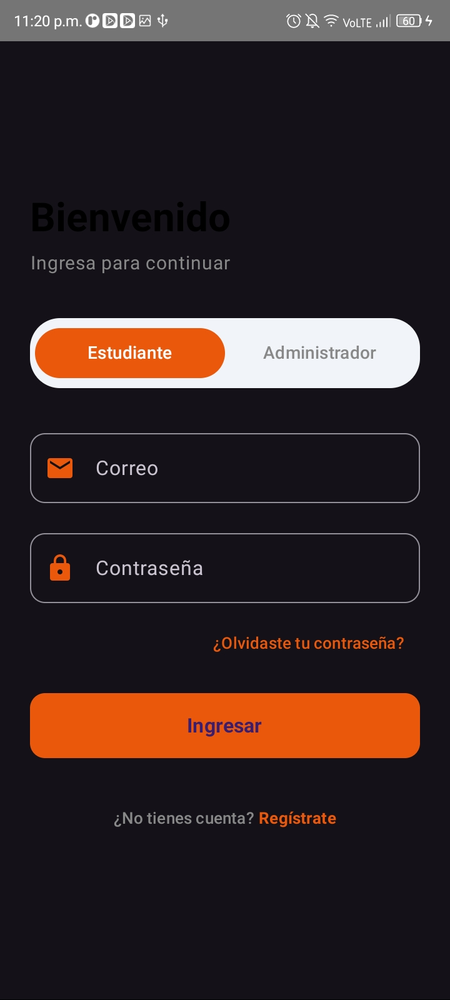
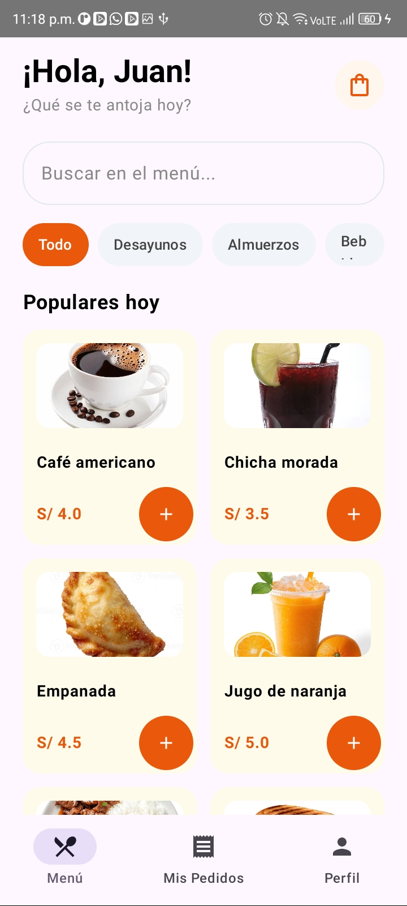
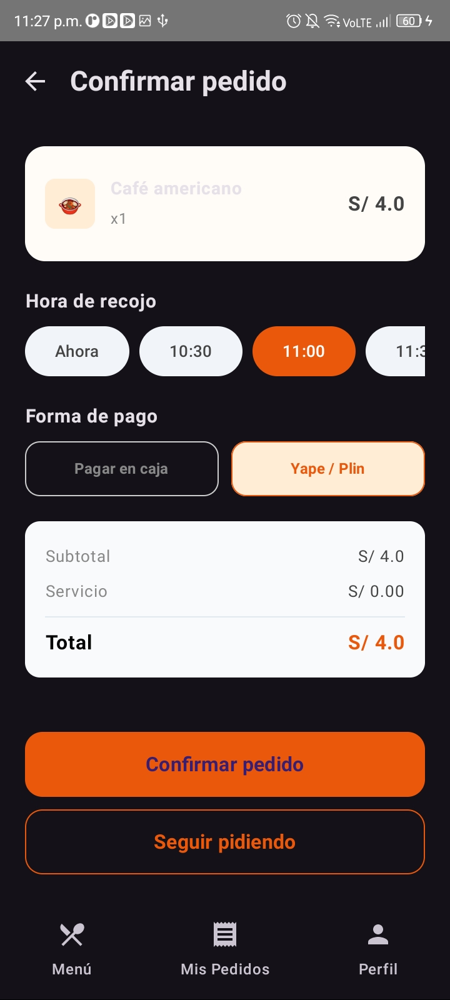
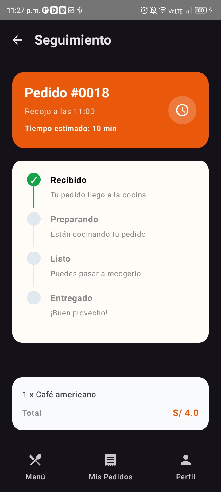
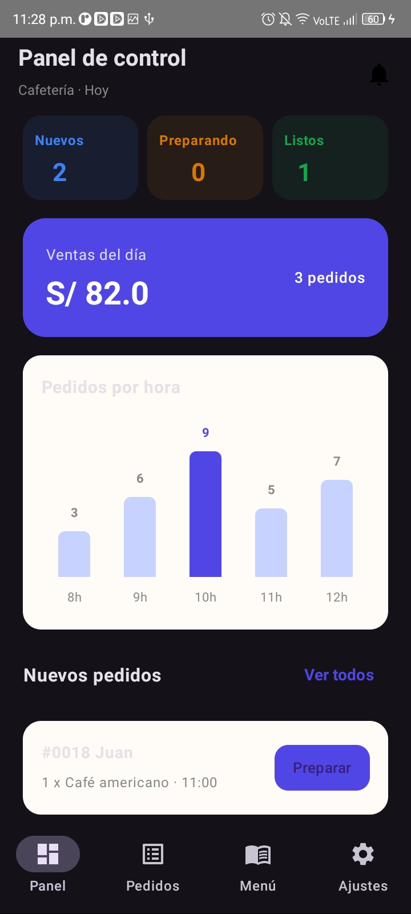
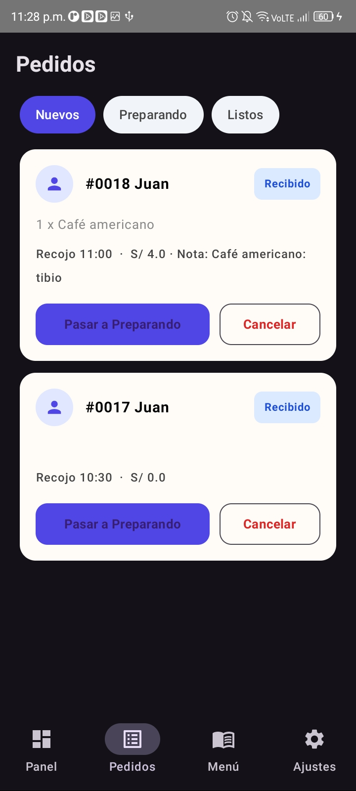

# ☕ CafeCampus - Aplicación Móvil de Gestión y Pedidos

**Curso:** Programaciones Móviles  
**Estudiante:** Ana Yanira Merino Ramos  
**Docente:** Juan Jose León Suiyon  
**Carrera:** Diseño y Desarrollo de Software  
**Ciclo Académico:** Cuarto Ciclo (4to Ciclo)  
**Sección:** C24-A

---

## 📖 Descripción del Programa
**CafeCampus** is una aplicación móvil nativa desarrollada para optimizar y digitalizar el proceso de pedidos y gestión en una cafetería estudiantil. El sistema está estructurado bajo una arquitectura limpia **MVVM** (Model-View-ViewModel), utilizando componentes modernos de **Jetpack Compose** para la interfaz gráfica, base de datos local **Room** para la persistencia transaccional y **Preferences DataStore** para el control de estados gerenciales y preferencias del usuario. La aplicación opera bajo dos roles independientes:
- **Módulo Estudiante:** Permite la exploración de un catálogo en tiempo real con filtrado por categorías, personalización de comandas mediante notas especiales en el carrito, selección de horarios de recojo y un seguimiento visual interactivo del estado de los pedidos.
- **Módulo Administrador:** Ofrece un panel de control gerencial con indicadores de ventas, contadores de comandas, gráficos estadísticos de pedidos por hora y un sistema completo de administración (CRUD) de platos y disponibilidad.

---

## 📋 Desarrollo y Preguntas del Entregable

### 1. ¿Cuál es el problema que resuelve la aplicación y a qué necesidad responde?
La aplicación resuelve el problema de la congestión, la falta de transparencia en los tiempos de espera y el manejo manual de comandas en las cafeterías de entornos educativos. Responde a la necesidad de automatizar la relación entre el estudiante y la administración, permitiendo realizar pedidos de forma anticipada, conocer el estado exacto de preparación (Recibido, Preparando, Listo, Entregado) y brindarle al administrador herramientas gerenciales basadas en datos en tiempo real.

### 2. ¿Cómo se aplicó la arquitectura MVVM y la persistencia de datos?
- **MVVM y StateFlow:** Se separó la lógica de presentación de la capa de datos mediante `ViewModel`s especializados (`MenuViewModel`, `PedidosClienteViewModel`, `PedidosAdminViewModel`, etc.). Se utilizaron flujos reactivos (`StateFlow` y `SharedFlow`) para que la interfaz se redibuje al instante cada vez que se emita una nueva orden, se actualice una nota en tiempo real o cambie el estado de un producto.
- **Room Database:** Se implementó como motor de base de datos local (SQLite) para asegurar la persistencia de entidades relacionales (`Usuario`, `Producto`, `Pedido`, `DetallePedido`), permitiendo consultas complejas y transacciones seguras sin depender de servidores externos.
- **Preferences DataStore:** Se empleó para almacenar configuraciones ligeras del dispositivo de forma asíncrona, tales como el modo oscuro persistente, las notificaciones de nuevos pedidos, la apertura/cierre de la cafetería y el almacenamiento temporal del rol activo para facilitar las pruebas de rol en modo práctica.

---

## 📸 Evidencias del Sistema (Capturas de Pantalla)

<table>
  <tr>
    <td align="center"><b>1. Pantalla de Login</b>  
      
    </td>
    <td align="center"><b>2. Catálogo (Estudiante)</b>  
      
    </td>
    <td align="center"><b>3. Confirmar Pedido y Notas</b>  
      
    </td>
  </tr>
  <tr>
    <td align="center"><b>4. Seguimiento Gráfico</b>  
      
    </td>
    <td align="center"><b>5. Panel Gerencial (Admin)</b>  
      
    </td>
    <td align="center"><b>6. Gestión de Comandas</b>  
      
    </td>
  </tr>
</table>

---

## 🤔 Preguntas para Pensar y Análisis Técnico

1. **¿Por qué el Repository es una interface?**  
   Para desacoplar el origen de los datos de la aplicación; de esta manera, podemos cambiar de Room a una API web sin alterar la lógica de los ViewModels ni romper el funcionamiento del código.

2. **¿Por qué `crearPedido` es `suspend` y `observarPedidosCliente` es `Flow`?**  
   `suspend` se utiliza para una acción rápida que se ejecuta una sola vez (como insertar un pedido en la base de datos), mientras que `Flow` emite datos continuamente de forma reactiva para mantener la lista actualizada en tiempo real ante cualquier cambio.

3. **¿Qué pasaría si dos perfiles usaran bases de datos distintas?**  
   Cada usuario vería información completamente aislada en su propio dispositivo o instancia; sin embargo, si comparten el mismo entorno sin filtrar por un identificador de usuario (`clienteId`), los datos y compras de ambos perfiles se mezclarían.

4. **¿Qué debería cambiar si mañana los datos viven en un servidor?**  
   Únicamente se requeriría crear una nueva clase que implemente la interfaz del Repository utilizando una librería de red como Retrofit en lugar de Room; los ViewModels y las vistas mantendrían su funcionamiento intacto.

---

## 🛠️ Tecnologías y Stack Utilizado
- **Lenguaje de Programación:** Kotlin
- **Interfaz de Usuario:** Jetpack Compose & Material Design 3
- **Navegación:** Jetpack Navigation Compose
- **Base de Datos:** Room Database (SQLite)
- **Persistencia de Sesión/Preferencias:** Jetpack Preferences DataStore
- **Control de Versiones:** Git & GitHub (Rama `sinia`)