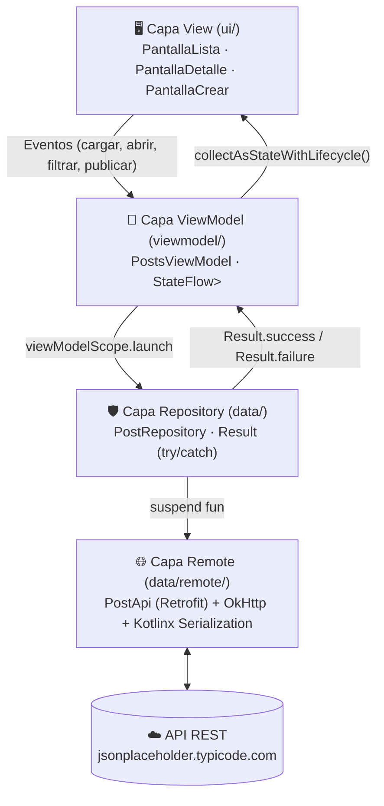

<div align="center">

# 📱 MuroCampus

**Cliente Android nativo construido con Jetpack Compose, Material 3, Retrofit y arquitectura limpia MVVM + Repository.**

[](https://kotlinlang.org/)
[](https://developer.android.com/jetpack/compose)
[](https://square.github.io/retrofit/)
[](#arquitectura-mvvm--repository)

*Laboratorio N° 09 — Programación en Móviles (4to Ciclo · TECSUP)*

</div>

---

## 📋 Descripción del Proyecto

**MuroCampus** es una aplicación móvil desarrollada en Kotlin y Jetpack Compose que consume la API REST pública de [JSONPlaceholder](https://jsonplaceholder.typicode.com/) para gestionar un muro de publicaciones universitarias.

### ✨ Funcionalidades Principales
* **Listado reactivo (`GET posts`):** Visualización de publicaciones mediante `LazyColumn` con tarjetas estilizadas en Material 3 y manejo explícito de estados (`Cargando`, `Éxito`, `Error` con reintento).
* **Detalle y comentarios en paralelo (`@Path`):** Consulta simultánea de una publicación (`GET posts/{id}`) y sus comentarios (`GET posts/{id}/comments`) mediante corrutinas concurrentes (`coroutineScope` + `async`).
* **Filtrado dinámico por autor (`@Query`):** Barra horizontal de `FilterChip` desplazables (`Todos` y `Usuario 1` a `Usuario 10`) conectada a `GET posts?userId={id}`.
* **Creación de publicaciones (`@POST` + `@Body`):** Formulario validado en tiempo real con `OutlinedTextField` que serializa objetos `NuevoPost` a JSON y muestra confirmación de respuesta HTTP `201`.
* **Resiliencia ante fallos de red:** Captura segura de `IOException`, `HttpException` y `SerializationException` encapsulada en `Result<T>`, evitando cierres inesperados sin conexión.

---

## 🗂️ Estructura de Paquetes

El proyecto sigue una separación estricta de responsabilidades bajo el paquete base `com.merino.murocampus`:

```text
com.merino.murocampus/
├── MainActivity.kt                  # Punto de entrada, Scaffold Material 3 y navegación de estados
├── model/
│   └── Modelos.kt                   # Data classes @Serializable (Post, Comentario, NuevoPost, Usuario)
├── data/
│   ├── PostRepository.kt            # Contrato PostRepository e implementación PostRepositoryRemote con Result<T>
│   └── remote/
│       ├── PostApi.kt               # Interface Retrofit con @GET, @POST, @Path, @Query y @Body
│       └── RetrofitClient.kt        # Singleton OkHttp + HttpLoggingInterceptor + Kotlinx Serialization
├── viewmodel/
│   ├── UiState.kt                   # Sealed interface UiState (Cargando, Exito, Error) y mapeo de errores
│   ├── PostViewModel.kt             # Gestión de StateFlow, corrutinas (viewModelScope) y lógica de presentación
│   └── ViewModelFactory.kt          # Inyección de dependencias manual para PostsViewModel
└── ui/
    ├── Componentes.kt               # Componentes reutilizables M3 (TarjetaPost, Cargando, ErrorConReintento)
    ├── PantallaLista.kt             # Muro principal con filtro de chips y lista de publicaciones
    ├── PantallaDetalle.kt           # Vista completa del post con sus comentarios y BackHandler
    ├── PantallaCrear.kt             # Formulario de creación de nueva publicación
    └── theme/                       # Paleta de colores, tipografía y tema Material 3
```

---

## 🏗️ Arquitectura MVVM + Repository

La aplicación implementa flujo de datos unidireccional (**UDF**) garantizando que la capa de interfaz nunca conozca detalles de red ni librerías HTTP:



### Reglas de Arquitectura Aplicadas
| Capa | Responsabilidad | Restricción Cumplida |
| :--- | :--- | :--- |
| **View (`ui/`)** | Dibuja la UI reactiva según `UiState` con `when`. | Nunca llama a `PostApi` ni maneja excepciones. |
| **ViewModel** | Orquesta llamadas asíncronas y expone `StateFlow`. | Sin referencias a `Retrofit`, `PostApi` ni `Context`. |
| **Repository** | Ejecuta llamadas remotas y encapsula errores en `Result`. | Relanza `CancellationException` y nunca filtra excepciones crudas. |
| **Remote** | Define endpoints HTTP y serialización JSON. | Sin estado de interfaz de usuario. |

---

## 📸 Capturas de Pantalla

| 1. Lista de Publicaciones | 2. Detalle y Comentarios | 3. Filtro por Usuario |
| :---: | :---: | :---: |
|  |  |  |
| *Listado general (`GET posts`)* | *Post completo + 5 comentarios (`@Path`)* | *Chips dinámicos (`@Query`)* |

| 4. Crear Publicación (`@POST`) | 5. Manejo de Error sin Conexión |
| :---: | :---: |
|  |  |
| *Respuesta `Publicado con id 101`* | *Control de `IOException` + Reintentar* |

---

## 💡 Para Pensar (Cuestionario Técnico)

### 1. ¿Qué diferencia hay entre `GET` y `POST`? ¿Por qué `crear` lleva `@Body` y `porUsuario` lleva `@Query`?
* **`GET` vs `POST`:** `GET` se utiliza para consultar y recuperar recursos del servidor sin alterar su estado (operación segura e idempotente), mientras que `POST` envía información nueva al servidor para crear un recurso.
* **`@Body` vs `@Query`:** `crear` usa `@Body` porque necesita enviar una estructura de datos completa (`NuevoPost` con `userId`, `title` y `body`) serializada como JSON en el cuerpo de la petición HTTP. En cambio, `porUsuario` usa `@Query("userId")` porque envía un parámetro simple de filtrado directamente en la URL (`posts?userId=2`).

### 2. ¿Por qué la ruta es `"posts"` y no `"/posts"`?
Porque la `baseUrl` configurada en Retrofit termina con barra diagonal (`https://jsonplaceholder.typicode.com/`). En Retrofit, si una ruta relativa comienza con `/`, se interpreta como una ruta absoluta desde la raíz del dominio, lo que eliminaría cualquier subruta o prefijo de versión (como `/api/v1/`) que tuviera la `baseUrl`.

### 3. ¿Por qué el Repository devuelve `Result` en vez de dejar que la excepción llegue al ViewModel?
Para mantener el **desacoplamiento de capas**. El `Repository` actúa como frontera de datos: captura excepciones técnicas de red o parseo (`IOException`, `HttpException`, `SerializationException`) y las transforma en un tipo seguro (`Result.failure`). De este modo, el `ViewModel` no depende de librerías de red y se limita a mapear `onSuccess` y `onFailure` hacia estados visuales (`UiState`).

### 4. ¿Qué pasa si olvidas el permiso `INTERNET`? ¿Y si olvidas `ignoreUnknownKeys` y el servidor agrega un campo nuevo?
* **Sin permiso `INTERNET`:** Android bloquea cualquier intento de abrir sockets de red a nivel de sistema operativo, provocando que todas las llamadas fallen inmediatamente con excepción de red (`SecurityException` / fallo de conexión) incluso si el dispositivo tiene Wi-Fi o datos móviles activos.
* **Sin `ignoreUnknownKeys = true`:** `kotlinx.serialization` aplica validación estricta por defecto; si el backend incorpora un campo nuevo en el JSON que no existe en nuestra `data class`, lanzará una `SerializationException` y la app mostrará el error `"Respuesta inesperada"`.

### 5. ¿Por qué la pantalla de lista usa un `when` sobre `UiState` y no un `if` con tres variables?
Porque `UiState` es una `sealed interface` que modela estados **mutuamente excluyentes**. Usar tres variables booleanas independientes (`isLoading`, `isError`, `data`) puede generar estados imposibles o contradictorios (como mostrar el indicador de carga y un mensaje de error al mismo tiempo). Con `when`, el compilador exige cubrir todos los casos posibles de forma exhaustiva y garantiza un único estado consistente en pantalla.

### 6. JSONPlaceholder no guarda los `POST`. ¿Cómo cambiaría tu app si usaras un servicio real?
En un backend real con persistencia en base de datos, el `POST` devolvería el objeto creado con su `id` real generado por el servidor y quedaría almacenado. En nuestra app, al volver a `PantallaLista` o refrescar el listado (`vm.cargar()`), la nueva publicación aparecería en el muro junto a las demás; además, sería necesario integrar cabeceras de autenticación (como tokens Bearer/JWT mediante un `Interceptor` de OkHttp) y manejo de sesiones de usuario.

---

<div align="center">
Desarrollado por <b>Ana Yanira Merino Ramos</b> · TECSUP 2026
</div>