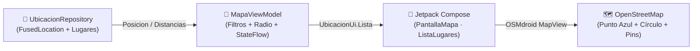

# 🤖 CampusGPS — Registro de Ingeniería Asistida por IA (Fase 2)

Documentación técnica de las iteraciones realizadas con **Gemini en Android Studio** sobre la rama de mejoras (`conia` / `mejora-ia`). Cada intervención fue auditada para garantizar que **ninguna regla de MVVM + Repository fuera vulnerada** (sin `Context` en el `ViewModel` y sin lógica de negocio o cálculos dentro de los `@Composable`).

---

## 🏗️ Flujo de Arquitectura Preservado

---

## 📋 Bitácora Técnica de Prompts y Criterio Arquitectónico

| # | Objetivo de la Mejora | Prompt Exacto Utilizado | Respuesta de Gemini | Ajustes y Validación Técnica | Por qué (Criterio MVVM) |
| :-: | :--- | :--- | :--- | :--- | :--- |
| **1** | **Migración a OpenStreetMap + Punto Azul Nativo** *(Capa: `View`)* | «En CampusGPS, reemplaza la vista de Google Maps en `MapaUbicacion.kt` por OpenStreetMap (`org.osmdroid:osmdroid-android:6.1.20`) usando `AndroidView` con `MapView` y gestión de ciclo de vida (`LifecycleEventObserver` para `onResume`, `onPause` y `onDetach`). 1. Agrega la dependencia `implementation("org.osmdroid:osmdroid-android:6.1.20")` en `app/build.gradle.kts` y asegúrate de tener `INTERNET` y `ACCESS_NETWORK_STATE` en `AndroidManifest.xml`, eliminando la dependencia de `MAPS_API_KEY`. 2. Configura `Configuration.getInstance().userAgentValue = context.packageName`, `TileSourceFactory.MAPNIK` y `setMultiTouchControls(true)`. 3. Agrega el parámetro `tienePermiso: Boolean` en `MapaUbicacion` y, solo cuando sea `true` (cuando `PantallaMapa` esté en estado `UbicacionUi.Lista`), activa `MyLocationNewOverlay(GpsMyLocationProvider(context), map).apply { enableMyLocation() }` y un botón flotante para centrar la cámara en la ubicación del usuario. 4. Mantén el marcador propio "Estás aquí", los 5 marcadores de lugares (destacando el más cercano y el seleccionado) y la animación de cámara sin modificar ni meter Context en `MapaViewModel` ni `UbicacionRepository`.» | Generó la integración de `MapView` dentro de `AndroidView`, configuró `TileSourceFactory.MAPNIK`, vinculó el ciclo de vida del `LifecycleOwner` y condicionó `MyLocationNewOverlay` al parámetro `tienePermiso`. | Se verificó que `Context` quedara encapsulado únicamente dentro de `LocalContext.current` en el Composable `MapaUbicacion`, manteniendo `MapaViewModel` y `UbicacionRepositoryGoogle` completamente desacoplados del motor de renderizado del mapa. | **Separación de responsabilidades:** Cambiar el proveedor visual de Google Maps a OpenStreetMap no debe alterar la capa de datos ni el `ViewModel`. Condicionar `enableMyLocation()` a `tienePermiso` evita excepciones de seguridad (`SecurityException`). |
| **2** | **Filtrado por Categoría con Chips** *(Capas: `ViewModel` + `View`)* | «Implementa el filtrado por categoría en CampusGPS respetando estrictamente MVVM: 1. En `Modelos.kt`, agrega `val categoriaSeleccionada: String = "Todas"` y `val lugaresFiltrados: List<LugarConDistancia>` dentro de `UbicacionUi.Lista`. 2. En `MapaViewModel.kt`, almacena la lista completa de lugares calculados y crea `fun seleccionarCategoria(categoria: String)` que actualice el `StateFlow` filtrando por `"Todas"`, `"Estudio"`, `"Comida"`, `"Eventos"` o `"Servicios"`. 3. En `PantallaMapa.kt`, agrega una fila horizontal (`LazyRow`) de `FilterChip` de Material 3 con esas 5 categorías y pasa `estado.lugaresFiltrados` tanto a `MapaUbicacion` (para mostrar solo esos marcadores en OpenStreetMap) como a `ListaLugares`. Regla estricta: Todo el filtrado debe ocurrir en `MapaViewModel`, nunca dentro de los Composables.» | Extendió `UbicacionUi.Lista` con `categoriaSeleccionada` y `lugaresFiltrados`, implementó `seleccionarCategoria()` en `MapaViewModel` respaldado por una lista privada completa y conectó los `FilterChip` en `PantallaMapa`. | Se validó que `ListaLugares` y `MapaUbicacion` recibieran directamente `estado.lugaresFiltrados` sin aplicar `.filter { ... }` dentro de la vista. | **Composables puros (Stateless UI):** La vista solo debe renderizar el estado emitido por el `StateFlow`. Ejecutar filtrados dentro de `@Composable` provoca recomposiciones innecesarias y dificulta las pruebas unitarias del `ViewModel`. |
| **3** | **Radio de Cercanía Geográfico** *(Capas: `ViewModel` + `View`)* | «Implementa un selector de radio de cercanía (100 m, 200 m y 500 m) compatible con OpenStreetMap (`osmdroid`) y MVVM: 1. En `Modelos.kt`, agrega `val dentroDelRadio: Boolean = true` en `LugarConDistancia` y `val radioMetros: Double = 200.0` en `UbicacionUi.Lista`. 2. En `MapaViewModel.kt`, crea `fun cambiarRadio(nuevoRadio: Double)` y calcula `dentroDelRadio = distanciaMetros <= radioMetros` dentro del `ViewModel` cada vez que cambie la ubicación o el radio seleccionado. 3. En `MapaUbicacion.kt`, recibe `radioMetros: Double` y dibuja un círculo alrededor de la posición del usuario usando `org.osmdroid.views.overlay.Polygon` con `Polygon.pointsAsCircle(puntoUsuario, radioMetros)`, relleno azul translúcido (`0x221565C0`) y borde azul (`0xFF1565C0`). 4. En `PantallaMapa.kt` y `ListaLugares.kt`, agrega 3 `FilterChip` (`100 m`, `200 m`, `500 m`) que llamen a `vm.cambiarRadio(...)` y muestra una etiqueta visual "Dentro del radio" en las tarjetas donde `dentroDelRadio` sea true. No realices comparaciones matemáticas de distancia dentro de los Composables.» | Implementó `cambiarRadio(nuevoRadio)` en `MapaViewModel`, precalculó el booleano `dentroDelRadio` en cada `LugarConDistancia` y añadió un `Polygon` circular geográfico en `osmdroid` sincronizado con la posición del usuario. | Se comprobó que el orden de parámetros y cálculos geodésicos permanecieran centralizados en `DistanciaUtil` y `MapaViewModel`, dejando en `ListaLugares` solo la lectura de `item.dentroDelRadio`. | **Centralización de reglas de negocio:** Determinar si un punto está dentro del umbral de proximidad (`distancia <= radio`) es lógica de dominio que pertenece al `ViewModel`, no a la capa de presentación. |
| **4** | **Rediseño UI/UX, Jerarquía Visual e Iconografía** *(Capa: `View`)* | «Actúa como un diseñador experto en UI/UX móvil y desarrollador senior de Kotlin con Jetpack Compose (Material 3). Rediseña la interfaz visual y distribución de `PantallaMapa.kt`, `MapaUbicacion.kt` y `ListaLugares.kt` de mi proyecto CampusGPS usando OpenStreetMap (`osmdroid`), manteniendo toda la lógica de negocio y filtrado estrictamente dentro de `MapaViewModel`: 1. **Jerarquía y flujo vertical limpio (sin superposiciones):** Elimina el botón "Obtener mi ubicación" y los textos de coordenadas de encima del mapa. Usa una `Column` estructurada en 4 zonas claras de arriba hacia abajo: Zona de Mapa (42% de altura, con `SmallFloatingActionButton` azul `#1565C0`), Panel de Estado y Acción Rápida (`Surface` `#F4F7FB` con botones "Actualizar ubicación" e "Ir al más cercano" + coordenadas), Barra de Filtros Dual (Categoría con íconos + Radio `100 m`, `200 m`, `500 m`) y Lista de Lugares (`weight(1f)`). 2. **Punto azul circular personalizado en OpenStreetMap (`MapaUbicacion.kt`):** En `MyLocationNewOverlay`, reemplaza el ícono verde por defecto generando un `Bitmap` circular limpio de 44x44 px con borde blanco grueso y centro azul (`#1565C0`) mediante `setPersonIcon(...)` y `setDirectionIcon(...)`. Personaliza los marcadores de los lugares con tintes diferenciados: verde (`#2E7D32`) para el más cercano, azul (`#1565C0`) para el seleccionado y gris azulado para el resto. 3. **Tarjetas de Lista enriquecidas (`ListaLugares.kt`):** Contenedor circular con ícono por categoría (`MenuBook`, `Restaurant`, `Event`, `LocalParking`), nombre en negrita, insignia celeste `"En radio"`, distancia en `#1565C0`, etiqueta `"Más cercano"` en verde (`#2E7D32`) y resaltado con borde de `2.dp` azul (`#1565C0`) y fondo `#E3F2FD` al seleccionar.» | Reestructuró el layout eliminando superposiciones sobre el mapa, generó el `Bitmap` circular personalizado en `Canvas` para `MyLocationNewOverlay`, asignó iconografía semántica Material Rounded por categoría y aplicó jerarquía visual en las tarjetas. | Se verificó que el `Bitmap` personalizado y los recursos gráficos se crearan dentro de `remember` en la capa UI sin filtrar referencias gráficas hacia el `ViewModel`. | **Usabilidad y MVVM limpio:** Mejorar la legibilidad, el contraste y el feedback táctil en Compose debe resolverse exclusivamente con tokens de diseño Material 3 y estado inmutable proveniente de `UbicacionUi`. |

---

## ✅ Resumen de Mejoras Implementadas

* **🗺️ Independencia de API Keys:** Migración completa de Google Maps SDK a **OpenStreetMap (`osmdroid`)** con gestión explícita del ciclo de vida en Compose (`LifecycleEventObserver`).
* **🔵 Indicador GPS Personalizado:** Punto azul circular de alta visibilidad con halo blanco (`MyLocationNewOverlay` customizado) y botón flotante de centrado rápido.
* **🏷️ Filtrado Reactivo por Categoría:** Chips interactivos (`Todas`, `Estudio`, `Comida`, `Eventos`, `Servicios`) sincronizados en tiempo real entre el mapa y la lista.
* **📡 Radar de Proximidad Dinámico:** Selector de radio (`100 m`, `200 m`, `500 m`) con representación poligonal sobre el mapa e insignias de cercanía en cada tarjeta.
* **🎨 Jerarquía Visual Material 3:** Eliminación de elementos superpuestos sobre el mapa mediante un flujo vertical en 4 bloques y tarjetas enriquecidas con iconografía semántica.