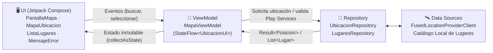

# 📍 CampusGPS


Aplicación móvil nativa para Android desarrollada en **Kotlin** y **Jetpack Compose** que obtiene la ubicación geográfica en tiempo real del usuario mediante **Google Play Services Location** (`FusedLocationProviderClient`), renderiza puntos de interés cercanos sobre **Google Maps SDK**, calcula distancias geodésicas y ordena dinámicamente los lugares según su proximidad, gestionando de forma segura permisos y errores de hardware/servicios.

---

## 📋 Tabla de Contenidos

- [Arquitectura MVVM](#-arquitectura-mvvm)
- [Árbol de Paquetes](#-árbol-de-paquetes)
- [Capturas de Pantalla](#-capturas-de-pantalla)
- [Para Pensar (Análisis Técnico)](#-para-pensar-análisis-técnico)
- [Configuración y Ejecución](#-configuración-y-ejecución)

---

## 🏗️ Arquitectura MVVM

El proyecto implementa el patrón arquitectónico **Model - View - ViewModel (MVVM)** bajo un flujo de datos unidireccional (**UDF**) con `StateFlow` y corrutinas vinculadas al ciclo de vida (`viewModelScope`).



### Responsabilidades por Capa

| Capa | Paquete | Responsabilidad Principal |
| :--- | :--- | :--- |
| **Model** | `model` | Define los modelos de dominio (`Posicion`, `Lugar`, `LugarConDistancia`), la clasificación de errores (`TipoError`) y la máquina de estados sellada (`UbicacionUi`). |
| **View** | `ui` | Composables reactivos que observan `StateFlow` con `collectAsState()` y delegan acciones al `ViewModel`, sin contener lógica de negocio ni acceso directo al SDK. |
| **ViewModel** | `viewmodel` | Coordina la consulta asíncrona de ubicación, calcula y ordena las distancias y preserva el estado ante cambios de configuración (rotación de pantalla). |
| **Repository** | `data` | Encapsula la obtención de coordenadas GPS (`UbicacionRepositoryGoogle`) y el catálogo de puntos del campus (`LugaresRepository`), desacoplando `Context` del `ViewModel`. |

---

## 📂 Árbol de Paquetes

```text
app/src/main/java/com/merino/campusgps/
├── MainActivity.kt                     # Punto de entrada, edge-to-edge e instanciación de dependencias
├── data/
│   ├── LugaresRepository.kt            # Catálogo con los 5 puntos de interés del campus
│   ├── UbicacionRepository.kt          # Interfaz de contrato para ubicación y disponibilidad de Play Services
│   └── UbicacionRepositoryGoogle.kt    # Implementación con FusedLocationProviderClient y GoogleApiAvailability
├── model/
│   └── Modelos.kt                      # Posicion, Lugar, LugarConDistancia, TipoError y sealed interface UbicacionUi
├── ui/
│   ├── ListaLugares.kt                 # Lista LazyColumn ordenada por cercanía con resaltado de selección
│   ├── MapaUbicacion.kt                # Mapa de Google con cámara animada y marcadores personalizados
│   ├── MensajeError.kt                 # Vista de error contextual con botones Abrir ajustes / Reintentar
│   ├── PantallaMapa.kt                 # Contenedor principal, solicitud de permisos y renderizado de estados
│   └── theme/                          # Esquema de colores, tipografía y tema Material 3
├── util/
│   └── DistanciaUtil.kt                # Cálculo de distancia con Location.distanceBetween() y formateo (m / km)
└── viewmodel/
    └── MapaViewModel.kt                # Gestión de StateFlow, ordenamiento por distancia y mapeo de errores
```

---

## 📱 Capturas de Pantalla

| 1. Permiso de Ubicación | 2. Mapa con Ubicación Actual | 3. Marcadores e InfoWindow |
| :---: | :---: | :---: |
|  |  |  |
| *Diálogo nativo solicitando `ACCESS_FINE_LOCATION` y `ACCESS_COARSE_LOCATION`.* | *Cámara centrada en el usuario con el marcador **"Estás aquí"** y coordenadas.* | *Visualización de puntos cercanos con nombre, categoría y distancia.* |

| 4. Lista Ordenada y Selección | 5. Manejo de Estados de Error |
| :---: | :---: |
|  |  |
| *Lugares ordenados de menor a mayor distancia (`m`/`km`) y resaltado activo.* | *Mensaje descriptivo con acción **Abrir ajustes** o **Reintentar** sin cierres.* |

---

## 💡 Para Pensar (Análisis Técnico)

### 1. ¿Por qué `FusedLocationProviderClient` está dentro del Repository y no en el ViewModel?
Porque el `ViewModel` debe mantenerse libre de dependencias del framework de Android (`Context`, sensores o servicios de ubicación) para evitar fugas de memoria (*memory leaks*), facilitar las pruebas unitarias mediante implementaciones simuladas (*fakes/mocks* de `UbicacionRepository`) y respetar el principio de responsabilidad única: el `ViewModel` administra el estado de la interfaz, mientras que el `Repository` abstrae el acceso al hardware.

### 2. ¿Qué diferencia hay entre el permiso de ubicación y la clave de API de Maps? ¿Qué pasa si falta cada uno?
* **Permiso de ubicación (`ACCESS_FINE_LOCATION` / `ACCESS_COARSE_LOCATION`):** Es una autorización de privacidad otorgada por el **usuario** en tiempo de ejecución para que la aplicación acceda al GPS y sensores del dispositivo. Si falta, `FusedLocationProviderClient` lanza una `SecurityException` y la app no puede obtener las coordenadas del usuario ni calcular distancias, aunque el mapa base sí puede cargarse.
* **Clave de API de Maps (`MAPS_API_KEY`):** Es una credencial vinculada a un proyecto de **Google Cloud** que autentica a la aplicación para descargar los mosaicos (*tiles*) cartográficos. Si falta o es inválida, la app sigue obteniendo coordenadas GPS y dibujando marcadores/controles, pero el fondo del mapa se visualiza en blanco (sin calles ni relieve).

### 3. ¿Por qué la clave va en `local.properties` y no en el código? ¿Qué harías si se subiera a GitHub por error?
`local.properties` está ignorado por defecto en `.gitignore`, evitando exponer credenciales privadas en el historial de versiones y previniendo el uso no autorizado de cuota o cargos en Google Cloud.  
Si la clave se subiera a GitHub por error:
1. **Revocaría o regeneraría inmediatamente** la clave comprometida desde Google Cloud Console.
2. **Restringiría la nueva clave** por nombre de paquete (`com.merino.campusgps`), huella digital **SHA-1** y únicamente a la API *Maps SDK for Android*.
3. **Limpiaría el historial de Git** mediante `git filter-repo` o BFG Repo-Cleaner y ejecutaría un `force push` para eliminar cualquier rastro de los commits anteriores.

### 4. ¿Dónde calculas la distancia y por qué no en el Composable?
La distancia se calcula en la utilidad `DistanciaUtil.kt` (mediante `Location.distanceBetween`) y es invocada dentro del **`MapaViewModel`** (`actualizarDistancias`) cada vez que se recibe una nueva posición. No se realiza dentro del Composable porque las funciones `@Composable` se recomponen con alta frecuencia (al desplazar el mapa, hacer scroll o tocar elementos); ejecutar cálculos geodésicos y ordenamientos de listas durante la recomposición degradaría el rendimiento de la interfaz y mezclaría lógica de negocio con presentación.

### 5. ¿Qué pasa con tu app si el usuario niega el permiso dos veces? ¿Cómo lo manejas?
En Android (a partir de Android 11 / API 30), si el usuario rechaza el permiso en dos ocasiones (o marca *"No volver a preguntar"*), el sistema lo considera **denegado permanentemente**: las siguientes llamadas a `ActivityResultContracts.RequestMultiplePermissions` omiten el diálogo del sistema y devuelven `false` de inmediato.  
En **CampusGPS** lo manejamos capturando ese resultado negativo en `PantallaMapa`, llamando a `vm.permisoDenegado()` para emitir `UbicacionUi.Error(..., TipoError.SIN_PERMISO)` y mostrando en `MensajeError` el botón **Abrir ajustes**, que lanza un `Intent` con `Settings.ACTION_APPLICATION_DETAILS_SETTINGS` dirigido a los ajustes de la app para que el usuario habilite el permiso manualmente.

---

## ⚙️ Configuración y Ejecución

1. Clona el repositorio y ubícate en la rama correspondiente (`sinia` o `main`).
2. Agrega tu clave de Google Maps en el archivo `local.properties` en la raíz del proyecto:
   ```properties
   MAPS_API_KEY=TU_CLAVE_DE_GOOGLE_MAPS
   ```
3. Sincroniza el proyecto con Gradle y ejecútalo en un dispositivo físico o emulador con **Google Play Services**.